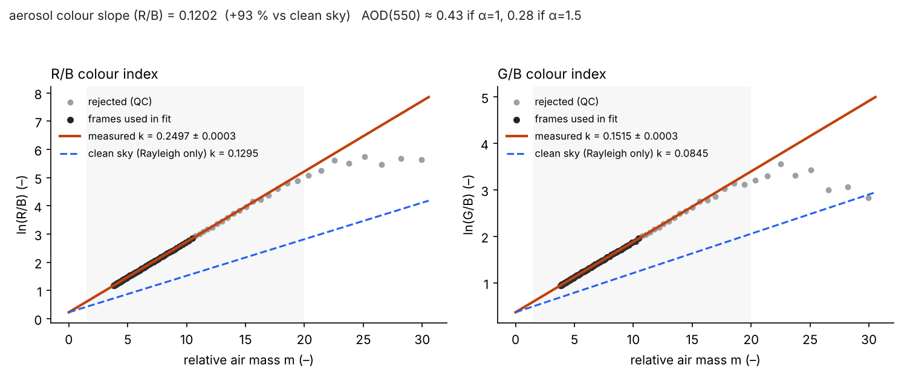

# sky-colour-aerosols

Measuring how much aerosol is in the air from photos of sunsets and sunrises.

This is **Stage A** of a larger project linking sky colour to air pollution, ecosystems and biodiversity:

```
Ecosystem / land use ──► Emissions ──► Transport ──► Aerosol properties ──► Optics ──► Sky colour
                                                     └──────────── Stage A (this repo) ────────────┘
```

Stage A answers one narrow, testable question: **given a sequence of photos of the setting (or rising) sun, how much does the colour change faster than a perfectly clean atmosphere would allow, and what aerosol load does that imply?** Stage B (planned) will attribute that aerosol to sources (urban, dust, smoke, forest emissions, sea salt) and compare sites such as Montréal, Paris and Lebanon.



*Synthetic test sunset (true β = 0.15, α = 1.3). Black points are frames that passed quality control; grey points were rejected because the blue channel became too dark to measure. The red line is the measured slope; the blue dashed line is what a clean, Rayleigh-only sky would give.*

---

## 1. The physics in one page

As the sun drops, its light crosses more atmosphere. The **relative air mass** *m* goes from 1 at zenith to about 38 at the horizon (Kasten and Young, 1989). Each camera channel *c* (R, G, B) is dimmed by Beer–Lambert extinction:

$$S_c(m) = K_c\,F_{0,c}\,\exp\!\big[-m\,(\tau_R(\lambda_c) + \tau_a(\lambda_c))\big], \qquad \tau_a(\lambda) = \beta\,\lambda^{-\alpha}$$

| Symbol | Meaning | Units |
|---|---|---|
| *S_c* | sun-disk signal in channel *c* (background-subtracted) | arbitrary |
| *K_c F_{0,c}* | camera response × sun colour outside the atmosphere | arbitrary, unknown |
| τ_R(λ) | Rayleigh optical depth (Bodhaine et al., 1999) | – |
| τ_a(λ) | aerosol optical depth (AOD) | – |
| β | Ångström turbidity, AOD at 1 µm | – |
| α | Ångström exponent: > 1.5 fine (smoke, urban), < 0.5 coarse (dust, sea salt) | – |
| λ | wavelength | µm |

Taking the log-ratio of a long and a short channel gives a **colour index that is linear in air mass**:

$$CI_{RB}(m) = \ln\frac{S_R}{S_B} = c_{RB} + m\,k_{RB}, \qquad k_{RB} = \underbrace{\tau_R(\lambda_B) - \tau_R(\lambda_R)}_{\text{clean sky}} + \underbrace{\beta\,(\lambda_B^{-\alpha} - \lambda_R^{-\alpha})}_{\text{aerosol colour slope}}$$

The intercept *c* absorbs everything unknown about the camera (white balance, sensor response, exposure), so **no absolute calibration is needed**. This is the same idea as the Langley method used in sun photometry (Shaw, 1983). Only the slope carries atmospheric information.

### What colour can and cannot tell you

This is the most important result of Stage A, and it shaped the outputs:

1. **The robust measurement is the aerosol colour slope**, *k_RB* minus its clean-sky value. It is model-light and needs no assumption about the aerosol type.
2. **Colour only sees the *spectral contrast* of aerosol, not its total amount.** Grey aerosol (α → 0, e.g. coarse desert dust) dims all channels equally and is nearly invisible in colour. Converting the colour slope into AOD at 550 nm therefore needs α. The tool reports AOD for a range of assumed α values (0.25 to 2.0) instead of pretending to know it.
3. **Solving for α from RGB alone is ill-conditioned.** The three camera channels span only 0.465–0.610 µm. A 1 % error in the slopes moves α by roughly 0.3–0.5. On synthetic data, the free α retrieval is never well constrained once realistic errors are included, and the tool says so explicitly. The practical route is to take α from a co-located or climatological source (AERONET, MODIS/VIIRS) and use the photos for the AOD.
4. **Same camera, different days** cancels most systematic errors. Comparing sunsets (Montréal summer vs winter, smoke days vs clear days) is far more reliable than any single absolute value.

---

## 2. Quick start

```bash
git clone https://github.com/<you>/sky-colour-aerosols.git
cd sky-colour-aerosols
python -m pip install -r requirements.txt

# 1. Check the pipeline on a synthetic sunset with known aerosol
python -m skycolour synth demo_frames --beta 0.10 --alpha 1.3 --fmt png
python -m skycolour process demo_frames --out demo_results --slope-sys 0.005 --wavelength-sd 0

# 2. Run on your own photos
python -m skycolour process path/to/sunset_2026-10-09 \
    --out results/montreal_2026-10-09 \
    --lat 45.5017 --lon -73.5673 --tz America/Toronto
```

Useful options:

| Option | Default | When to use it |
|---|---|---|
| `--tz` | – | Camera time zone, needed if EXIF has no UTC offset (`America/Toronto`, `Europe/Paris`, `Asia/Beirut`) |
| `--lat`, `--lon` | from GPS EXIF | Site coordinates in decimal degrees (+N, +E) |
| `--clock-offset-s` | 0 | Seconds to **add** to camera time to get true time |
| `--altitude-m` | sea level | Mountain sites: lowers Rayleigh scattering (e.g. 1800 m ≈ 815 hPa) |
| `--airmass-min/max` | 1.5 / 20 | Fit window. Lower the maximum if mountains or buildings block the horizon |
| `--alpha-fixed` | – | Solve AOD for a known α (e.g. from AERONET) |
| `--wavelengths R G B` | 0.610 0.535 0.465 | Effective channel wavelengths (µm) for your sensor |
| `--wavelength-sd` | 0.010 | Uncertainty of those wavelengths (µm). Lower once calibrated |
| `--slope-sys` | 0.02 JPEG, 0.005 RAW | Relative systematic slope error used in the uncertainty |
| `--roi X0 Y0 X1 Y1` | whole image | Search box for the sun, to ignore bright clouds or reflections |
| `--manifest file.csv` | – | Times/locations from a CSV (`file,time[,lat,lon]`) instead of EXIF |

---

## 3. Outputs

Each run writes three files to `--out`.

**`frames.csv`**: one row per photo, kept even when rejected, so the run is fully auditable.

| Column | Meaning | Units |
|---|---|---|
| `time` | corrected photo time | ISO 8601 with offset |
| `elevation_true_deg`, `azimuth_deg` | solar position (NOAA/Meeus algorithm, ±0.01° vs NREL SPA) | deg |
| `airmass` | relative air mass (Kasten and Young, 1989) | – |
| `cx`, `cy`, `radius_px` | sun-disk centre and equivalent radius | px |
| `flux_R/G/B` | background-subtracted integrated sun signal (linear) | arbitrary |
| `snr_R/G/B` | signal-to-noise of each flux | – |
| `sky_R/G/B`, `sky_CI_RB` | near-sun sky colour (annulus at 2–3 aperture radii) | linear / – |
| `CI_RB`, `CI_GB` | ln(R/B), ln(G/B) colour indices | – |
| `saturated_frac`, `black_frac_max` | clipped fraction of sun aperture / sky ring | – |
| `qc_ok`, `qc_reason` | quality-control decision and every reason for rejection | – |

**`summary.json`**: fits and retrieval, in order of reliability.

| Key | Meaning |
|---|---|
| `fit_RB`, `fit_GB` | slope, intercept, slope standard error, R², n, sigma-clipped points |
| `clean_sky_slope_RB` | baseline slope for a Rayleigh-only atmosphere |
| `aerosol_colour_slope_RB` | measured minus clean-sky slope: **the main result** |
| `excess_reddening_RB_pct` | the same, as % above clean sky |
| `aod_550_given_alpha` | AOD at 550 nm for α = 0.25, 0.5, 1.0, 1.5, 2.0 |
| `retrieval` | free (β, α) inversion with a `reliability` flag |
| `bootstrap.ci95*` | 95 % intervals combining frame bootstrap and systematic Monte Carlo |

**`colour_index_vs_airmass.png`**: diagnostic plot like the one above.

### Quality control

A frame is rejected (and the reason recorded) if any of the following apply:

- No timestamp or location.
- Sun elevation below 0.5°.
- Sun not found (peak/background contrast < 5).
- Sun disk saturated (> 0.2 % of aperture pixels clipped).
- Signal-to-noise below 30 in any channel.
- Sky ring black-clipped (> 10 % of pixels at zero, meaning the channel is underexposed).
- Sun too close to the image edge.

The fit then sigma-clips (3σ) any remaining outliers.

---

## 4. How to photograph a sequence

The method is only as good as the photos. Full protocol in [`docs/shooting_protocol.md`](docs/shooting_protocol.md); the essentials:

1. **Shoot RAW** (or RAW + JPEG). JPEG compression and tone curves biased the slope by about 2–3 % in testing, which was enough to nearly halve the AOD estimate for coarse aerosol.
2. **Tripod, manual everything:** fixed white balance (Daylight), fixed ISO (lowest), manual focus. Exposure can change between frames, since only ratios matter, but **the sun disk must never clip**. Use a fast shutter (1/4000 s or faster), small aperture, or an ND filter (about 10 stops near the horizon, more when the sun is higher).
3. **One frame every 30–60 s**, from about 15° elevation down to the horizon (about 1 hour before sunset). For sunrise, reverse the order.
4. **Fix the clock:** photograph a phone showing GPS time once per session, then pass `--clock-offset-s`. Near the horizon, one minute of clock error changes the air mass by more than 10 %.
5. **Clear line of sight** to the sun along the whole sequence. Thin uniform haze is the signal; clouds crossing the disk are noise and get sigma-clipped.
6. Note the site, altitude and anything notable (smoke smell, dust, humidity, wind direction).

---

## 5. Validation

### Tests

`pytest` runs 28 tests covering:

- Rayleigh optical depth against the independent Hansen and Travis (1974) formula (< 1 %).
- Air mass limits (1 at zenith, about 38 at the horizon).
- Solar position against NREL SPA via `pvlib` (< 0.02°).
- An exact forward–inverse round trip.
- Grey-aerosol invisibility.
- EXIF and manifest parsing.
- Every QC rejection path.
- The full CLI.

### Synthetic end-to-end validation

Run `python examples/validate_synthetic.py`. It generates 6 aerosol cases (β ∈ {0.05, 0.15} × α ∈ {0.5, 1.3, 2.0}) as real image files with EXIF, runs the full pipeline, and compares the results to the truth. Full results are in [`docs/validation.csv`](docs/validation.csv).

| Input | Mean \|slope error\| | 95 % CI covers true aerosol slope | AOD within CI if α known | Free α well constrained |
|---|---|---|---|---|
| Linear (RAW-like), calibrated camera | 0.17 % | 6 / 6 | 6 / 6 | 0 / 6 |
| JPEG, calibrated camera | 2.5 % | 6 / 6 | 6 / 6 | 0 / 6 |
| JPEG, uncalibrated camera | 2.5 % | 6 / 6 | 6 / 6 | 0 / 6 |

**Reading the table:**

- With linear data and known α, AOD(550) is recovered within about 1 % (e.g. 0.326 true vs 0.328 retrieved).
- JPEG adds a systematic bias. The uncertainty model is sized to cover it, at the cost of much wider intervals.
- The free α retrieval never earns the "constrained" flag. This is the honest outcome described in section 1.

**Baselines:**

- *Clean sky*: k_RB = 0.1295 at sea level with the default wavelengths. Every result is reported relative to it.
- *Truth*: synthetic sequences with known β and α.

Real-world validation against AERONET is the first item in the roadmap.

---

## 6. Limitations

- **Effective wavelengths:** a camera channel is broadband (about 100 nm wide), and its effective wavelength shifts as the sun reddens. The defaults are typical values, not your sensor's. A ±10 nm uncertainty dominates the absolute error. Calibrate with published sensor spectral sensitivities (e.g. Jiang et al., 2013) or against an AERONET station on a clear day.
- **Single air-mass formula** for gas and aerosol. Aerosol sits lower than air, so its true air mass near the horizon is slightly larger. The default fit stops at m = 20 (about 1.9° elevation) partly for this reason.
- **Assumes the aerosol is constant during the sequence** (about 1 hour). Fronts, sea breezes or passing smoke plumes break the linearity; check R² and the residuals.
- **Direct sun only.** Sky-colour (scattered light) metrics are recorded but not yet modelled. They need multiple-scattering radiative transfer (e.g. libRadtran).
- **Local horizon:** mountains or buildings cut the low-sun frames. In Lebanon, for example, coastal sunrises happen behind Mount Lebanon. Lower `--airmass-max` accordingly.

---

## 7. Roadmap

- [ ] **Validate against AERONET** on real sequences (Paris has AERONET sites), using α from AERONET with `--alpha-fixed`.
- [ ] **Camera calibration:** fit effective wavelengths from a clear-day sequence with known AOD.
- [ ] **Multi-sunset comparison tool** (same camera): season, site and event contrasts with paired uncertainties.
- [ ] **Stage B:** CAMS reanalysis speciated AOD (dust, sea salt, organic matter, black carbon, sulfate), HYSPLIT back-trajectories, land cover and biogenic-emission covariates, and a structural model linking ecosystem → aerosol → colour.
- [ ] **Sites:** Montréal, Paris, Lebanon (coast vs mountain).

---

## 8. Project layout

```
skycolour/
  physics.py    Rayleigh, air mass, Ångström, forward model, (β, α) inversion
  solar.py      solar position from time and location
  image.py      linear RGB loading (RAW/JPEG/PNG/TIFF), sun detection, photometry
  metadata.py   EXIF time/GPS, manifest CSV
  fit.py        colour index vs air mass regression, bootstrap + systematics
  pipeline.py   folder → frames.csv → summary.json
  plots.py      diagnostic figure
  synthetic.py  synthetic sunsets with known aerosol, written with EXIF
  cli.py        command line
tests/          pytest suite
examples/       validate_synthetic.py
docs/           shooting protocol, validation results, figures
```

---

## References

Ångström, A. (1929). On the atmospheric transmission of sun radiation and on dust in the air. *Geografiska Annaler, 11*, 156–166.

Bodhaine, B. A., Wood, N. B., Dutton, E. G., & Slusser, J. R. (1999). On Rayleigh optical depth calculations. *Journal of Atmospheric and Oceanic Technology, 16*(11), 1854–1861. https://doi.org/10.1175/1520-0426(1999)016<1854:ORODC>2.0.CO;2

Hansen, J. E., & Travis, L. D. (1974). Light scattering in planetary atmospheres. *Space Science Reviews, 16*(4), 527–610. https://doi.org/10.1007/BF00168069

Holben, B. N., Eck, T. F., Slutsker, I., Tanré, D., Buis, J. P., Setzer, A., … Smirnov, A. (1998). AERONET—A federated instrument network and data archive for aerosol characterization. *Remote Sensing of Environment, 66*(1), 1–16. https://doi.org/10.1016/S0034-4257(98)00031-5

Jiang, J., Liu, D., Gu, J., & Süsstrunk, S. (2013). What is the space of spectral sensitivity functions for digital color cameras? In *Proceedings of the IEEE Workshop on Applications of Computer Vision (WACV)* (pp. 168–179).

Kasten, F., & Young, A. T. (1989). Revised optical air mass tables and approximation formula. *Applied Optics, 28*(22), 4735–4738. https://doi.org/10.1364/AO.28.004735

Meeus, J. (1991). *Astronomical algorithms*. Richmond, VA: Willmann-Bell.

Reda, I., & Andreas, A. (2004). Solar position algorithm for solar radiation applications. *Solar Energy, 76*(5), 577–589. https://doi.org/10.1016/j.solener.2003.12.003

Shaw, G. E. (1983). Sun photometry. *Bulletin of the American Meteorological Society, 64*(1), 4–10.

Zerefos, C. S., Gerogiannis, V. T., Balis, D., Zerefos, S. C., & Kazantzidis, A. (2007). Atmospheric effects of volcanic eruptions as seen by famous artists and depicted in their paintings. *Atmospheric Chemistry and Physics, 7*(15), 4027–4042. https://doi.org/10.5194/acp-7-4027-2007

---

## License

MIT. See [LICENSE](LICENSE).
